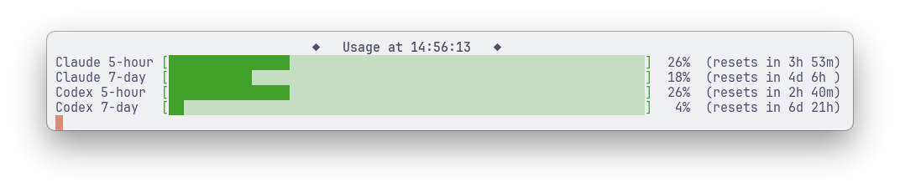

# MacOS AI Plan Meter (Claude & Codex)

Claude and Codex plan usage (5-hour, 7-day) in the macOS menu bar or the terminal.

## macOS menu bar app


### Requirements

- macOS 14+
- Claude: `claude` CLI logged in
- Codex: `codex login` with ChatGPT and file credential store (`~/.codex/auth.json`)

### Install

Quit any running copy, then:

```sh
gh release download agent-usage-latest -R tyrelh/ai-plan-usage-monitor -p agent-usage.zip --clobber
ditto -x -k agent-usage.zip ~/Applications
open ~/Applications/agent-usage.app
```

- Open the Claude panel and choose **Reconnect Claude…** if Keychain access is needed. Choose **Always Allow** when prompted.
- Browser download instead: `xattr -dr com.apple.quarantine ~/Applications/agent-usage.app`

Claude usage is fetched from the subscription API every ten minutes, including usage from other machines. The app caches the access token only in memory until shortly before expiry. Background refreshes never display Keychain prompts or launch Claude CLI. If access or renewal is needed, the panel keeps the last reading and offers **Reconnect Claude…**. Reconnecting can prompt for Keychain access and renew expired credentials through a small Claude CLI prompt that may use plan allowance.

### Menu bar markers

| Marker | Meaning |
|--------|---------|
| `…` | Loading |
| `!` | Error, showing last reading |
| `—` | Unavailable |

### Build

```sh
DEVELOPER_DIR=/Applications/Xcode.app/Contents/Developer xcodebuild \
  -project agent-usage/agent-usage.xcodeproj -scheme agent-usage \
  -configuration Debug -destination 'platform=macOS' \
  -derivedDataPath /tmp/agent-usage-build CODE_SIGN_IDENTITY=- build
open /tmp/agent-usage-build/Build/Products/Debug/agent-usage.app
```

Export menu bar images and status:

```sh
open /tmp/agent-usage-build/Build/Products/Debug/agent-usage.app --args --diagnostics /tmp/agent-usage-preview
```

### Test

```sh
DEVELOPER_DIR=/Applications/Xcode.app/Contents/Developer xcrun swiftc \
  agent-usage/agent-usage/UsageModels.swift tests/UsageParserChecks.swift \
  -o /tmp/agent-usage-parser-checks
/tmp/agent-usage-parser-checks
DEVELOPER_DIR=/Applications/Xcode.app/Contents/Developer xcrun swiftc \
  agent-usage/agent-usage/UsageModels.swift agent-usage/agent-usage/UsageClient.swift \
  tests/UsageClientChecks.swift -o /tmp/agent-usage-client-checks
/tmp/agent-usage-client-checks
```

## Terminal script



### Requirements

- macOS, `jq`, `curl`
- Claude: `claude` CLI logged in
- Codex: `codex` CLI logged in with ChatGPT (`~/.codex/auth.json`)

### Usage

```sh
./ai-plan-usage.sh --interval=600 --providers=claude,codex
```

| Flag | Default | Description |
|------|---------|-------------|
| `--providers=LIST` | `claude,codex` | Providers to show, in order |
| `--interval=N` | `600` | Seconds between refreshes |
| `--width=N` | `auto` | Bar width; `auto` fits terminal |
| `--full` | off | Print raw JSON |

### Adding a provider

- Add name to `PROVIDERS`
- `fetch_<name>`: print raw JSON, fail with message on stderr
- `rows_<name>`: JSON on stdin → `label<TAB>percent<TAB>reset` rows

## Credits

Logos from [Simple Icons](https://github.com/simple-icons/simple-icons) (CC0): [Claude](https://github.com/simple-icons/simple-icons/blob/develop/icons/claude.svg), [OpenAI](https://github.com/simple-icons/simple-icons/blob/15.0.0/icons/openai.svg). Marks belong to their owners.
